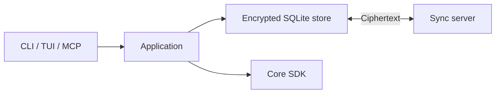
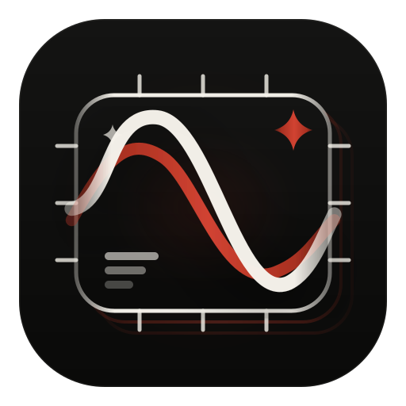
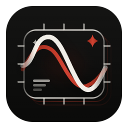

# Respire CLI

Local-first memory for AI tools, with encrypted storage, synchronization, a terminal interface and an HTTP/MCP runtime. Loopback access needs no token; non-loopback access requires authentication. The command is `rsrs`.



## Build

Use the pinned Rust toolchain and a Core SDK matching your target and `sdk/core-sdk.lock.json`.

```sh
export RSRS_CORE_SDK_DIR=/path/to/sdk
node scripts/fetch-core-sdk.mjs <rust-target>
cargo build --locked --release -p respire --bins
node scripts/stage-core-runtime.mjs target/release
```

On PowerShell, set `$env:RSRS_CORE_SDK_DIR`. Include the staged runtime libraries and notices with the executable. See [SDK setup](crates/core-sdk/README.md) and [Linux builds](docs/linux-build.md).

## Usage

Desktop integrations can use the bounded [host account RPC](docs/host-rpc.md) for password registration, login/TOTP, recovery and super-password reset without placing credentials in process arguments.

```sh
rsrs doctor
rsrs help
rsrs web
rsrs recall "query" --titles --json
rsrs extract --targets
rsrs extract --all --dry-run
```

`rsrs web` opens https://dash.rsrs.rs without starting a local Web server. No dashboard assets are embedded in the CLI.

Commands display compact human-readable tables by default, without duplicate summaries, empty action columns or result footers. Use `--json` for the machine-readable result envelope and diagnostic details. During automatic BGE-M3 preparation, `rsrs doctor` shows the current file, download percentage, transferred MB and background index state; `rsrs doctor --json` retains the complete task and index objects in `details`.

Blocking human commands report progress on stderr while keeping stdout as the final table. `sync` and `doctor` report their current stage and what they are waiting for; model installation reports file and transfer progress. Interactive terminals update one status line, and redirected stderr receives plain lines on stage changes or every five seconds while waiting. Fast commands avoid progress chatter. `--json` disables human progress.

In the TUI model page, choose a preset or custom download mirror. Saving a source during a download offers cancellation and restart. You can also cancel a model task or restart from the selected source; the runtime waits for cancellation before starting the replacement. Verified model files and the original memory data/index are retained.

The default profile is `~/.rsrs`, the local runtime port is `15169`, and the default sync API is `https://api.rsrs.rs`.

Use `rsrs login --oauth` for browser authorization, or `rsrs login --interactive` to choose OAuth or password/TOTP. The TUI account login offers the same choices. Select GitHub in the dashboard when the server has enabled it; complete any TOTP challenge and approve CLI access, then enter your super password in the terminal. Authorization alone does not decrypt your memories. Cancelled or failed login preserves the original account.

Login selects a nonempty `--addr`, then the selected account's nonempty `session.json` address, then `https://api.rsrs.rs`. `RSRS_ADDR` and `client.json` do not override this choice. OAuth and password login both require HTTPS; HTTP is allowed only for loopback fixtures. If a legacy stored address is rejected, select your server's HTTPS origin explicitly. For the official service, use `rsrs login --oauth --addr https://api.rsrs.rs`. Custom OAuth servers require a dashboard origin (`--dashboard <https-origin>` for noninteractive login). An invalid dashboard is reported separately from an invalid login server; rejected addresses are never automatically upgraded or echoed in the diagnostic.

For DEV acceptance, use `rsrs login --addr https://api-dev.rsrs.rs --oauth`. GitHub binding and unbinding are in the dashboard security page. Unbinding preserves the session; a GitHub-only account needs another login password before it can unlink GitHub. Production activation is separate from DEV delivery.

Startup preserves the selected account and does not import old profiles automatically. Use the TUI's Migrate old version action or `rsrs migrate` to choose a source and target account. Migration preserves encrypted data, settings and available credentials, keeps original directories intact and does not overwrite an existing account. Missing decryption credentials require the original recovery material.

`rsrs classify-config` reports classification configuration without invoking a model. Select a backend with `rsrs classify-config --set --backend jev` or `--backend ds --api-base <URL> --model <MODEL>`. Add `--key-stdin` to read a key from redirected input into the OS keyring; keys are never printed or stored in ordinary config files.

| Guide | Topic |
| --- | --- |
| [Session import](docs/session-import.md) | Extract coding-agent sessions into memories |
| [Runtime](docs/runtime.md) | Host lifecycle and sandbox clients |
| [Memory refresh](docs/memory-revision.md) | Read-only profile-scoped snapshot tokens |
| [Inference](docs/inference.md) | Model installation and engines |
| [Retrieval](docs/retrieval.md) | Retrieval modes and index migration |
| [npm launcher](npm/README.md) | Package layout and platform selection |
| [Platform support](docs/platform-support.md) | Release targets, requirements and blocked architectures |
| [WorkBuddy connector](connectors/workbuddy/README.md) | Tool integration |
| [Command checks](docs/command-regression.md) | Existing validation commands |

## Plugins

One engine, one plugin per host. Every adapter hooks the same `rsrs` engine into an agent loop: title-tier recall on each turn, one-prefix store (`记：` / `存：` / `remember:`), and a Stop storage check. A plugin never bundles the engine — when `rsrs` is missing it hands `npm i -g @rsrsai/cli@latest` to the agent. Setup guides: [plugin guides](https://docs.rsrs.rs/plugins/).

| | Host | Install | Repository |
| --- | --- | --- | --- |
|  | Codex (`@rsrsai/codex`) | `codex plugin marketplace add risense-ai/respire-codex --ref main`, then `codex plugin add respire@rsrsai` | [risense-ai/respire-codex](https://github.com/risense-ai/respire-codex) |
|  | Kimi Code | `/plugins install https://github.com/risense-ai/respire-kimi` | [risense-ai/respire-kimi](https://github.com/risense-ai/respire-kimi) |
|  | Dim | `dim plugin marketplace add .agents/plugins/marketplace.json`, then `dim plugin install respire@risense` | [risense-ai/respire-dimcode](https://github.com/risense-ai/respire-dimcode) |
|  | Qoder | `qoder plugins install <repo-path>`, or add the marketplace and `qoder plugins install respire-qoder@risense` | [risense-ai/respire-qoder](https://github.com/risense-ai/respire-qoder) |
|  | WorkBuddy | `bash install.sh`, or `codebuddy plugin install respire@risense-workbuddy` | [risense-ai/respire-workbuddy](https://github.com/risense-ai/respire-workbuddy) |
|  | Hermes Agent | `hermes plugins install respire`, then `hermes memory setup` | [risense-ai/respire-hermes](https://github.com/risense-ai/respire-hermes) |
|  | Pi (`@rsrsai/pi`) | `pi install npm:@rsrsai/pi` | [risense-ai/respire-pi](https://github.com/risense-ai/respire-pi) |
|  | ZCode | Add the repository directory as a marketplace source, then install `respire` | [risense-ai/respire-zcode](https://github.com/risense-ai/respire-zcode) |
|  | DeepSeek Harness (`@rsrsai/dsh`) | `plugin_manager` with `{"action":"install_bundle","target":"@rsrsai/dsh"}` | [risense-ai/respire-dsh](https://github.com/risense-ai/respire-dsh) |
|  | Magpie (`@rsrsai/magpie`) | `magpie plugin add @rsrsai/magpie` | [risense-ai/respire-magpie](https://github.com/risense-ai/respire-magpie) |

Icons are copied from each plugin repository into `docs/plugins/icons/`. Kimi Code, Qoder and Pi ship no logo file, so their rows use the shared Respire mark (`respire.svg`). All plugins read the same `respire.config.json` beside their hooks and invoke only `rsrs --client-only`.

## Clients

| | Client | Scope | Repository |
| --- | --- | --- | --- |
|  | Respire Client 2 | Wails v3 + Go desktop client for Windows, macOS and Linux. Native tray, runtime health, memory tree, recall, diary, model and index tasks, accounts and synchronization over loopback RPC. It downloads and manages its own `rsrs` CLI. [Releases](https://github.com/risense-ai/respire-client2/releases) | [risense-ai/respire-client2](https://github.com/risense-ai/respire-client2) |

## Release

DEV and stable releases run automatically after pushing `vX.Y.Z-dev.N` or
`vX.Y.Z` tags. See [release workflow](docs/releasing.md) for gates and timing.

## Test

```sh
export RSRS_CORE_TEST_MODE=1
cargo test --locked --workspace
```

Use isolated test data. `RSRS_CORE_TEST_MODE` selects existing test fixtures, not a production inference provider. Preserve protocol fields, user data formats and third-party notices. Do not commit credentials, databases, model files or build artifacts.

## License

First-party material uses the [Respire Noncommercial License 1.0](LICENSE).
Personal noncommercial use and self-hosting are permitted. Commercial use,
including internal business deployment, requires prior written authorization.
See [commercial licensing](COMMERCIAL-LICENSE.md).
